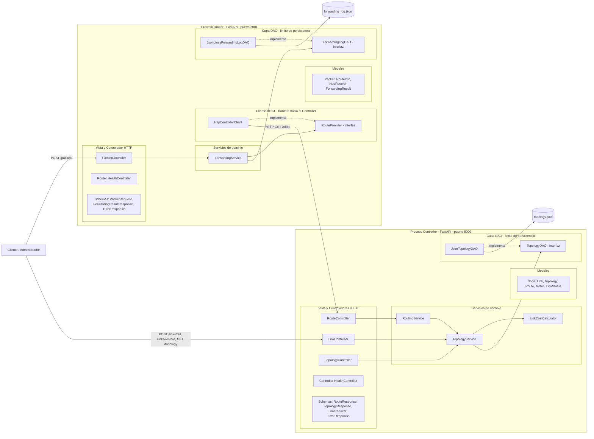
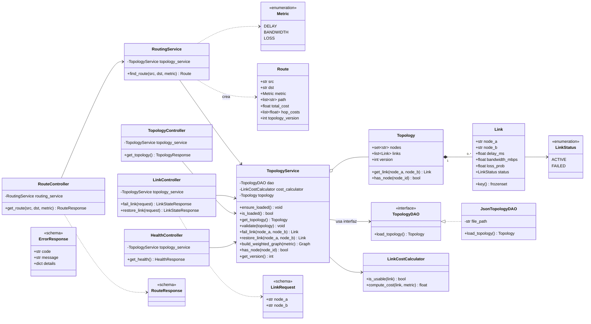
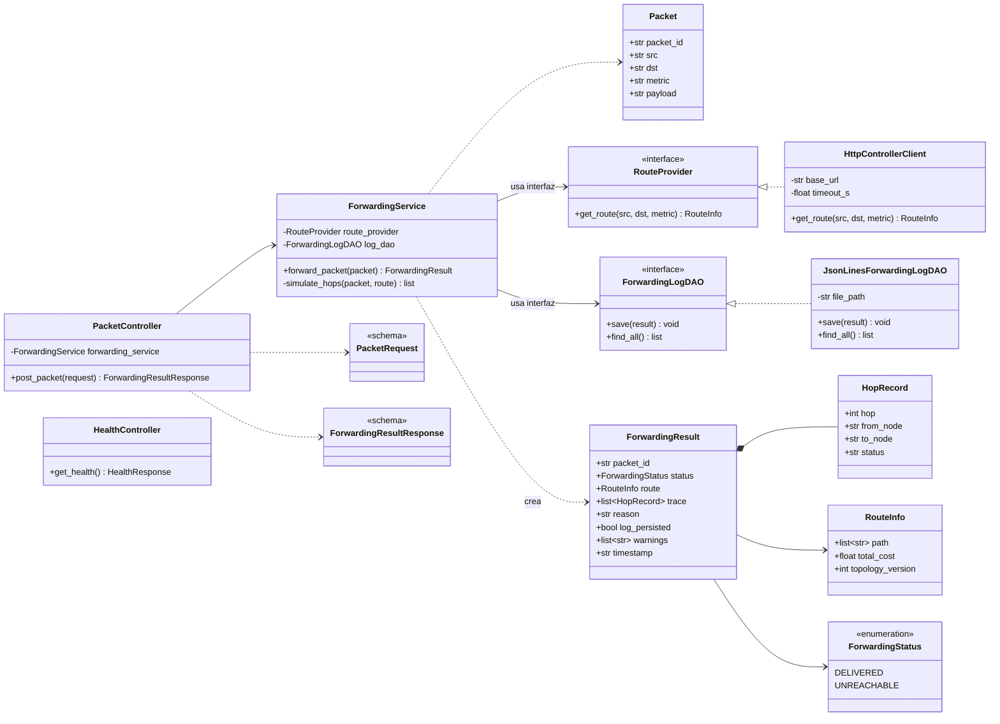

# 02 — Arquitectura Estática

> Define **qué componentes existen** y cómo se relacionan. Todas las clases usadas en `03-dynamic-architecture.md` aparecen aquí. Los diagramas están en Mermaid (se renderizan en GitHub, VS Code con extensión Mermaid o https://mermaid.live para exportar a PNG).

## 1. Diagrama de componentes



**Lectura del diagrama**
- La única conexión entre procesos es **HTTP/JSON** (`HttpControllerClient` → `RouteController`).
- Los accesos a archivos solo ocurren dentro de las clases DAO concretas.
- Los controladores HTTP solo conocen servicios y esquemas; los servicios solo conocen **interfaces** DAO.

## 2. Diagrama de clases — Controller



## 3. Diagrama de clases — Router



## 4. Responsabilidades de las clases

### Controller
| Clase | Capa | Responsabilidad |
|---|---|---|
| `Node`/`Link`/`Topology`/`Route` | Modelo | Objetos de dominio sin dependencias de HTTP ni de almacenamiento. |
| `RouteResponse`, `TopologyResponse`, `LinkRequest`, `ErrorResponse` | Vista | Esquemas Pydantic de entrada/salida (contrato JSON). |
| `RouteController`, `LinkController`, `TopologyController`, `HealthController` | Controlador | Traducen HTTP ⇄ servicios; **sin** lógica de enrutamiento ni acceso a datos. |
| `RoutingService` | Servicio | Ejecuta Dijkstra sobre el grafo ponderado y produce `Route`. Lanza `NodeNotFoundError` / `RouteNotFoundError`. |
| `TopologyService` | Servicio | Carga bajo demanda (`ensure_loaded`), valida la topología, mantiene estado de enlaces y versión, construye el grafo ponderado activo. |
| `LinkCostCalculator` | Servicio | Convierte atributos del enlace en costo ≥ 0 según la métrica; decide si el enlace es utilizable. |
| `TopologyDAO` / `JsonTopologyDAO` | DAO | Leer y parsear el JSON; no valida semántica. |

### Router
| Clase | Capa | Responsabilidad |
|---|---|---|
| `Packet`, `RouteInfo`, `HopRecord`, `ForwardingResult` | Modelo | Objetos de dominio del plano de datos. |
| `PacketRequest`, `ForwardingResultResponse`, `ErrorResponse` | Vista | Esquemas JSON de entrada/salida. |
| `PacketController`, `HealthController` | Controlador | Reciben HTTP, delegan en `ForwardingService`. |
| `ForwardingService` | Servicio | Pide la ruta vía `RouteProvider`, simula el reenvío salto a salto, arma el resultado y lo guarda con el DAO; captura `PersistenceError`. |
| `RouteProvider` / `HttpControllerClient` | Cliente REST | Interfaz y adaptador HTTP hacia `GET /route`; traduce fallos de red en `ControllerUnavailableError` / `ControllerTimeoutError`. |
| `ForwardingLogDAO` / `JsonLinesForwardingLogDAO` | DAO | Guardar y recuperar resultados de reenvío. |

## 5. Mapeo MVC por aplicación

| Capa MVC | Controller | Router |
|---|---|---|
| **Modelo** | `models/` (Node, Link, Topology, Route, Metric, LinkStatus) | `models/` (Packet, RouteInfo, HopRecord, ForwardingResult) |
| **Vista** | `schemas/` | `schemas/` |
| **Controlador** | `controllers/` | `controllers/` |
| **Servicios de dominio** | `services/` (RoutingService, TopologyService, LinkCostCalculator) | `services/` (ForwardingService) |
| **DAO** | `dao/` (TopologyDAO, JsonTopologyDAO) | `dao/` (ForwardingLogDAO, JsonLinesForwardingLogDAO) |
| **Cliente externo** | — | `clients/` (RouteProvider, HttpControllerClient) |

## 6. Inyección de dependencias

La **raíz de composición** (`main.py` de cada app) es el único lugar que conoce las clases concretas:

| App | Ensamblado |
|---|---|
| Controller | `JsonTopologyDAO(TOPOLOGY_FILE)` → `TopologyService(dao, LinkCostCalculator())` → `RoutingService(topology_service)` → controladores |
| Router | `HttpControllerClient(CONTROLLER_URL, CONTROLLER_TIMEOUT_S)` y `JsonLinesForwardingLogDAO(FORWARDING_LOG_FILE)` → `ForwardingService(route_provider, log_dao)` → `PacketController` |

- Se inyecta por **constructor**; los controladores reciben servicios mediante `Depends` de FastAPI.
- En pruebas se inyecta un `FakeTopologyDAO` / `FakeRouteProvider` / `FakeForwardingLogDAO` **sin tocar** `RoutingService` ni `ForwardingService` (NFR-07, NFR-09; TC-08, TC-09).

## 7. Reglas de diseño (verificables)

| Regla | Verificación |
|---|---|
| R1: `controllers/` no importa `networkx`, `heapq`, `json`, `pathlib` ni usa `open()`. | TC-12 |
| R2: `services/` no usa `open()`, `json.load`, `pathlib` ni importa implementaciones DAO concretas. | TC-13 |
| R3: `router/` no importa `networkx` ni implementa Dijkstra. | TC-14 |
| R4: Toda dependencia entre servicio y almacenamiento pasa por una interfaz (`TopologyDAO`, `ForwardingLogDAO`, `RouteProvider`). | Revisión + TC-08, TC-09 |
| R5: Solo `main.py` instancia clases concretas de DAO y cliente. | Revisión |
| R6: Los errores de dominio son excepciones propias traducidas a HTTP en un manejador central, no en los servicios. | TC-11 |

## 8. Estructura de directorios propuesta

```text
sdn-workshop/
├── specs/                      # 01..06 (+ README de la línea base)
├── controller/
│   ├── main.py                 # raíz de composición
│   ├── config.py
│   ├── controllers/            # route_, link_, topology_, health_controller
│   ├── schemas/
│   ├── models/
│   ├── services/               # routing_service, topology_service, link_cost_calculator
│   ├── dao/                    # topology_dao (interfaz), json_topology_dao
│   ├── exceptions.py           # errores de dominio + manejador HTTP
│   └── data/topology.json
├── router/
│   ├── main.py
│   ├── config.py
│   ├── controllers/            # packet_, health_controller
│   ├── schemas/
│   ├── models/
│   ├── services/               # forwarding_service
│   ├── clients/                # route_provider (interfaz), http_controller_client
│   ├── dao/                    # forwarding_log_dao (interfaz), jsonlines_forwarding_log_dao
│   ├── exceptions.py
│   └── data/
├── tests/
│   ├── controller/  router/  architecture/  integration/
│   └── test-results.txt
├── prompts-session1.md
├── prompts-session2.md
├── demo-evidence/
└── README.md
```

## 9. Trazabilidad requisito → componente

| Requisito | Componentes principales |
|---|---|
| FR-01 | `TopologyDAO`, `JsonTopologyDAO`, `TopologyService` |
| FR-02 | `TopologyService.validate`, `build_weighted_graph`, `Topology`, `Link` |
| FR-03 | `RoutingService`, `Route` |
| FR-04 | `LinkCostCalculator`, `Metric` |
| FR-05 | `RouteController`, `TopologyController`, `HealthController`, esquemas |
| FR-06 | `LinkController`, `TopologyService.fail_link/restore_link` |
| FR-07 | `RouteProvider`, `HttpControllerClient` |
| FR-08 | `PacketController`, `ForwardingService`, `HopRecord`, `ForwardingResult` |
| FR-09 | `exceptions.py` (ambas apps), manejadores de errores |
| FR-10 | `ForwardingLogDAO`, `JsonLinesForwardingLogDAO`, `ForwardingService` |
