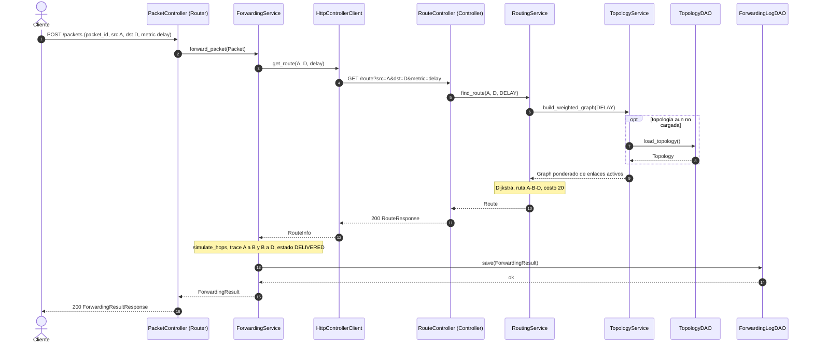
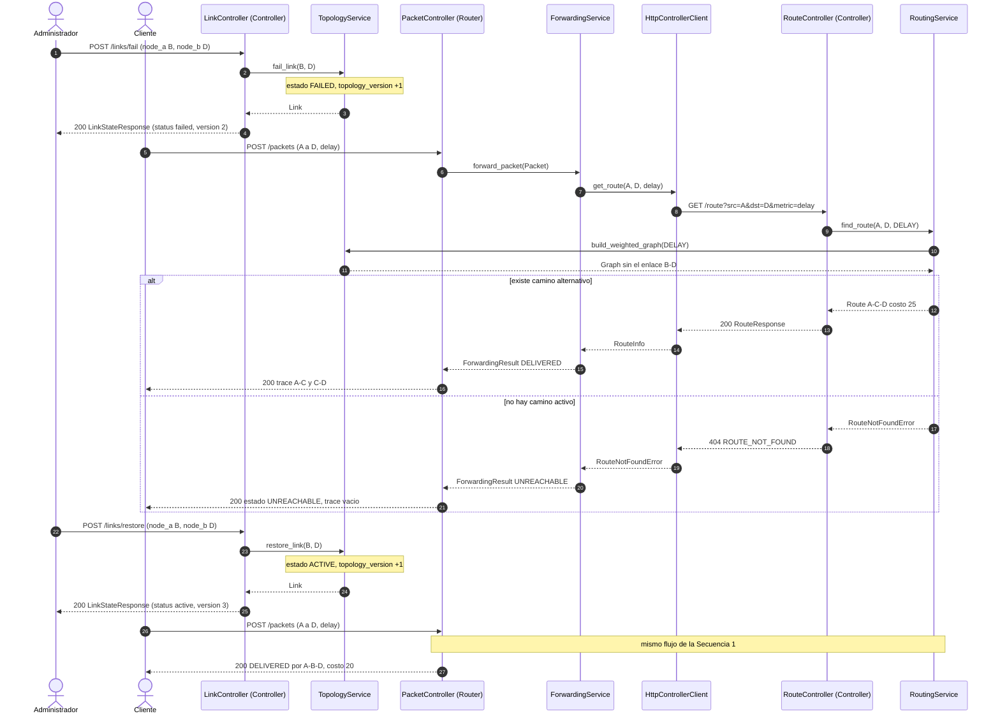
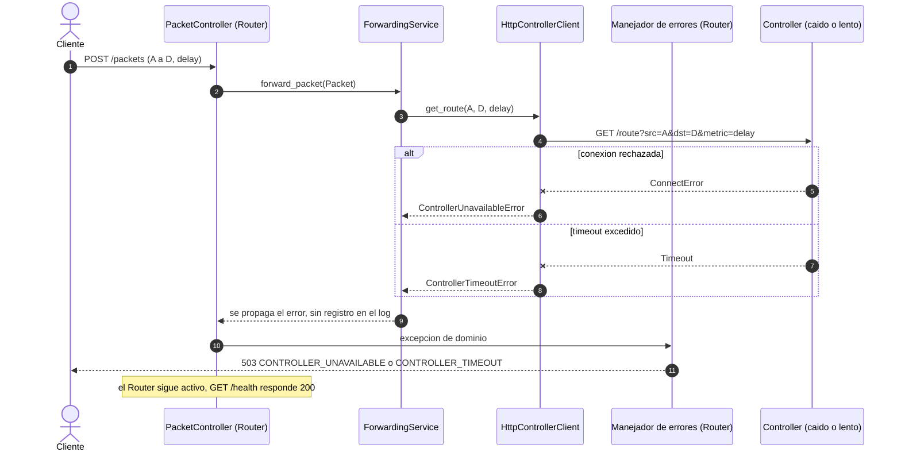

# 03 — Arquitectura Dinámica

> Describe **cómo interactúan** los componentes definidos en `02-static-architecture.md`. Todo participante es una clase de ese documento y todo mensaje HTTP coincide con `04-api-contract.md`.

Topología de referencia usada en los ejemplos: la de `06-test-spec.md` (nodos A–F; A→D por `delay` = `[A,B,D]`, costo 20).

---

## Secuencia 1 — Reenvío exitoso de un paquete

| # | Mensaje | Clase / método | Contrato |
|---|---|---|---|
| 1 | Paquete entra al Router | `PacketController.post_packet` | `POST /packets` |
| 2 | Se delega al servicio | `ForwardingService.forward_packet` | — |
| 3–4 | Se pide la ruta (el Router **no** calcula) | `HttpControllerClient.get_route` → `RouteController.get_route` | `GET /route` |
| 5–8 | Se construye el grafo activo y se obtiene la topología (carga diferida vía DAO) | `RoutingService.find_route`, `TopologyService.build_weighted_graph`, `TopologyDAO.load_topology` | — |
| 9–11 | Dijkstra → `Route` → respuesta JSON | `RoutingService`, `RouteController` | `200 RouteResponse` |
| 12–13 | Simulación salto a salto | `ForwardingService.simulate_hops` | — |
| 14–15 | Registro del resultado | `ForwardingLogDAO.save` | FR-10 |
| 16–17 | Respuesta final | `PacketController` | `200 ForwardingResultResponse` |

**Requisitos cubiertos:** FR-01, FR-03, FR-05, FR-07, FR-08, FR-10, NFR-03, NFR-09. **Pruebas:** TC-05, TC-06, TC-16.

---

## Secuencia 2 — Fallo y recuperación de un enlace

| Escenario | Resultado esperado |
|---|---|
| Fallo B–D, camino alternativo (C–D activo) | Ruta `[A,C,D]`, costo 25, `topology_version` = 2 |
| Fallo B–D **y** C–D | Controller: 404 `ROUTE_NOT_FOUND`; Router: 200 con `UNREACHABLE` |
| Restablecer B–D | Ruta `[A,B,D]`, costo 20, `topology_version` = 3 |
| Fallar un enlace ya caído | 409 `LINK_ALREADY_FAILED` (sin cambio de versión) |

**Requisitos cubiertos:** FR-03, FR-06, FR-08, FR-09. **Pruebas:** TC-03, TC-04, TC-07, TC-11, TC-16.

---

## Secuencia 3 — Controller no disponible (error de conexión o timeout)

| Aspecto | Comportamiento |
|---|---|
| Detección | `HttpControllerClient` captura errores de `httpx` (conexión, timeout, 5xx) y lanza excepciones de dominio. |
| Tiempo máximo | `CONTROLLER_TIMEOUT_S` (2 s por defecto); respuesta 503 en ≤ timeout + 1 s (NFR-11). |
| Reintentos | Ninguno (decisión A-04). |
| Registro | No se crea `ForwardingResult`, por lo tanto no se escribe en el log (decisión A-10). |
| Respuesta estable | `{"error": {"code": "CONTROLLER_UNAVAILABLE", "message": "...", "details": {}}}` |

**Requisitos cubiertos:** FR-07, FR-09, NFR-06, NFR-11. **Pruebas:** TC-07, TC-19.

---

## Coherencia entre diagramas, clases y API

| Verificación | Resultado |
|---|---|
| Todo participante de las secuencias existe en `02-static-architecture.md` | Sí (PacketController, ForwardingService, HttpControllerClient, RouteController, RoutingService, TopologyService, TopologyDAO, ForwardingLogDAO, LinkController) |
| Todo mensaje HTTP existe en `04-api-contract.md` | `POST /packets`, `GET /route`, `POST /links/fail`, `POST /links/restore` |
| Todo método llamado existe en el diagrama de clases | `forward_packet`, `get_route`, `find_route`, `build_weighted_graph`, `load_topology`, `save`, `fail_link`, `restore_link`, `post_packet` |
| Los códigos de error coinciden con el catálogo de `01-requirements.md` §7 | Sí |
